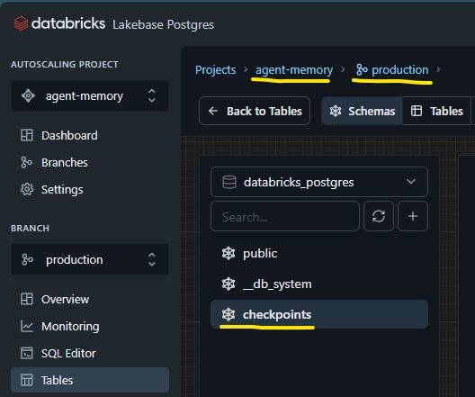

## Additional Prerequisite
- A Lakebase Autoscaling Project with a branch and schema to store the short-term memory checkpoints. Store these names in the `memory.env` file.

## Start the agent server
- run `python start_server.py`

## Start the client chatbot
- run `python client.py`

## Additions to the In-memory Agent:
- Use `WorkspaceClient()` with profile name to interact with remote Databricks workspace asset (in addition to the MLflow server)
- `acquire_lakebase_resources()` is a request-scoped async context manager
- Moved agent init into @stream function because of the following:
    - TBU
    - TBU

## Client - Server Working
- See [chatbot-responsesagent/README.md](../chatbot-responsesagent/README.md)